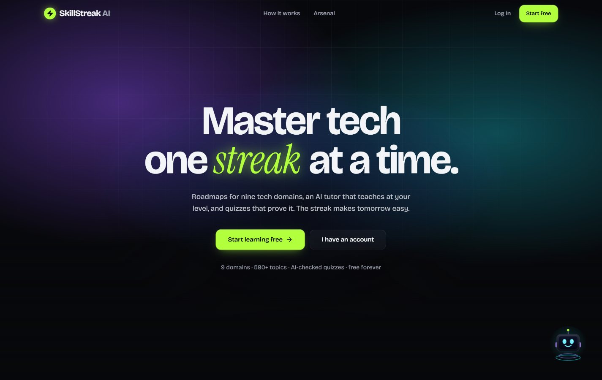
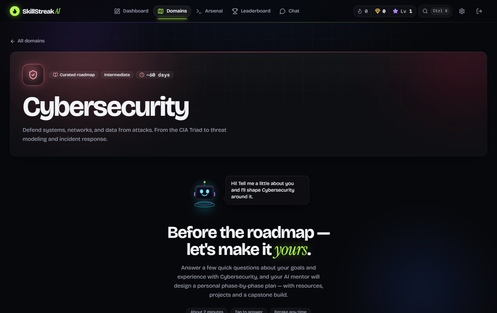
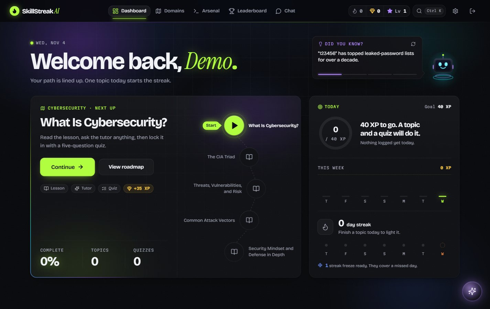
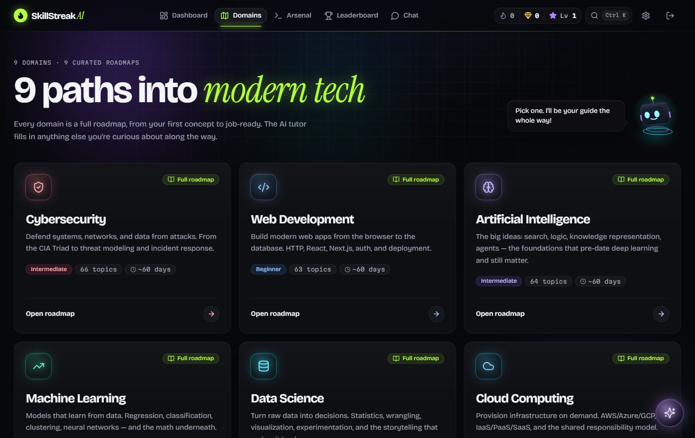
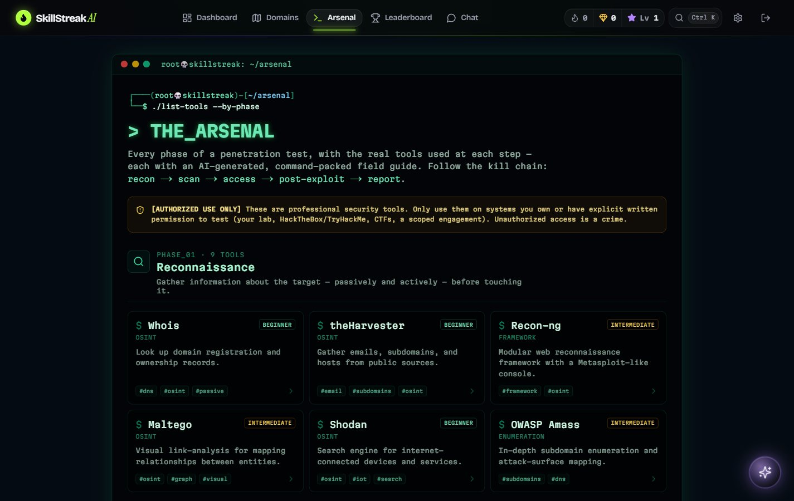
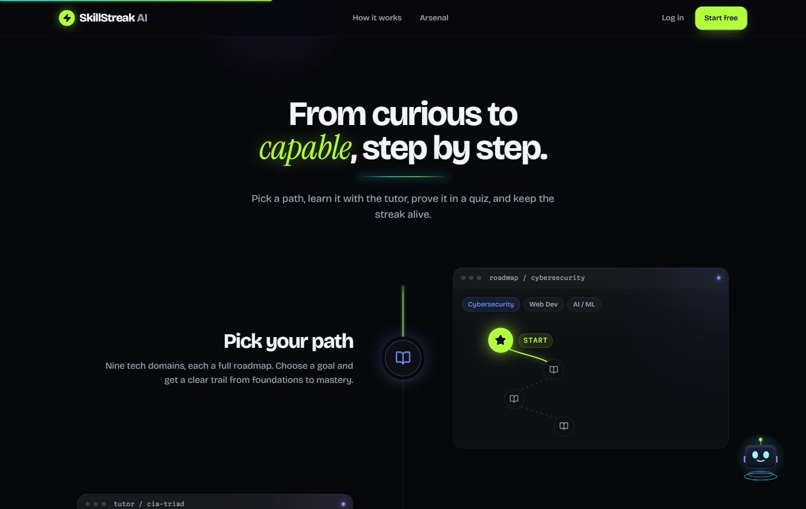
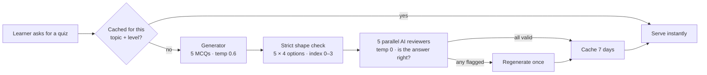
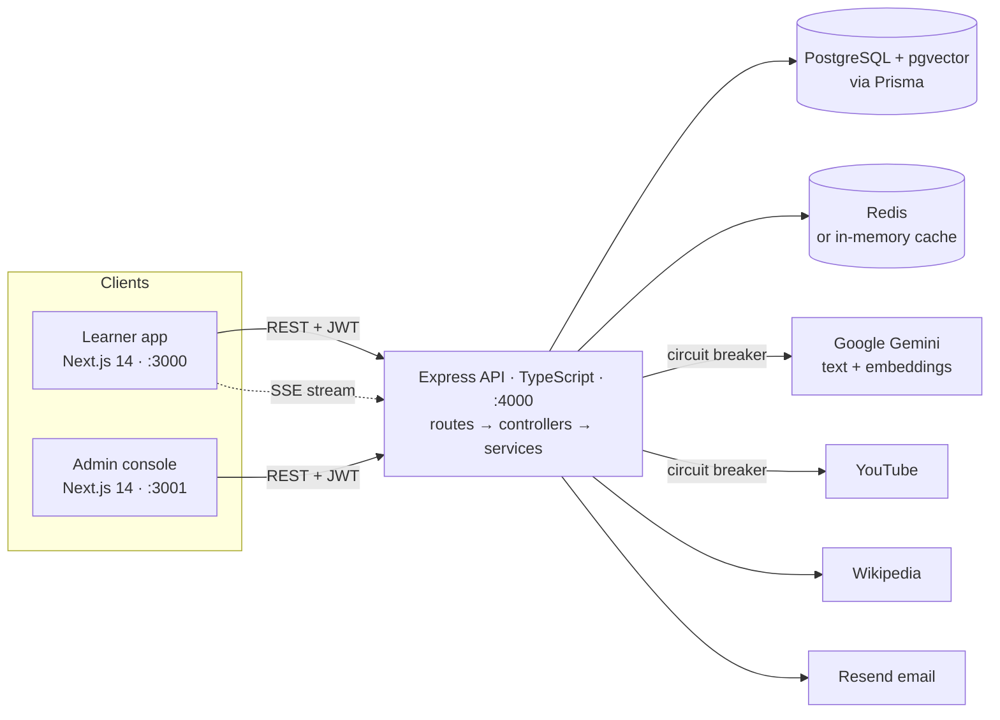
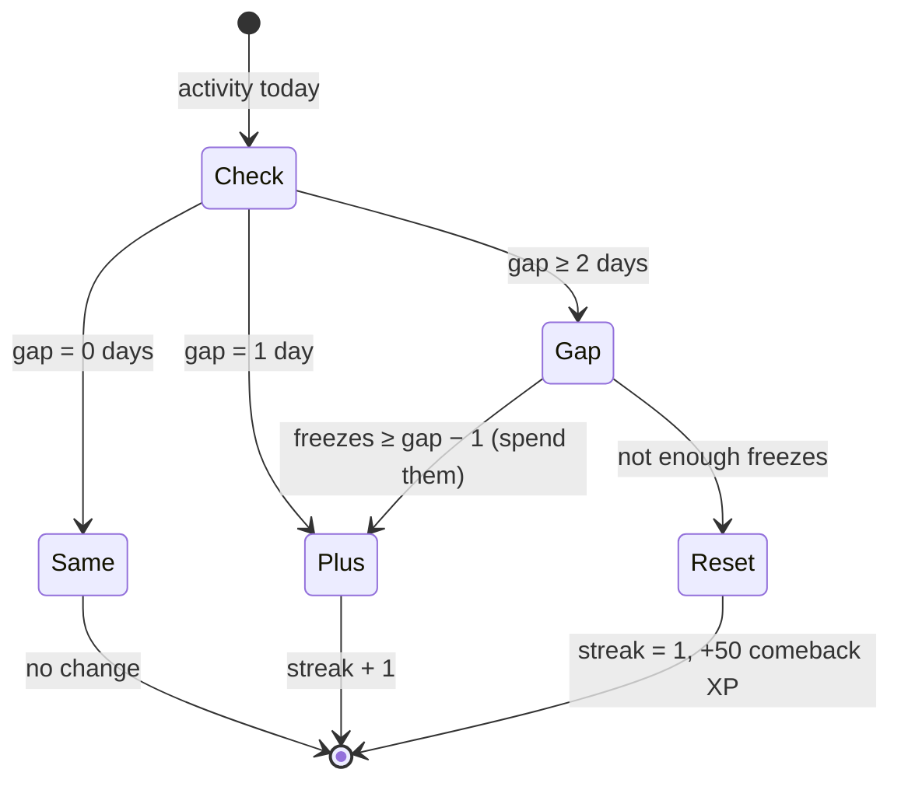
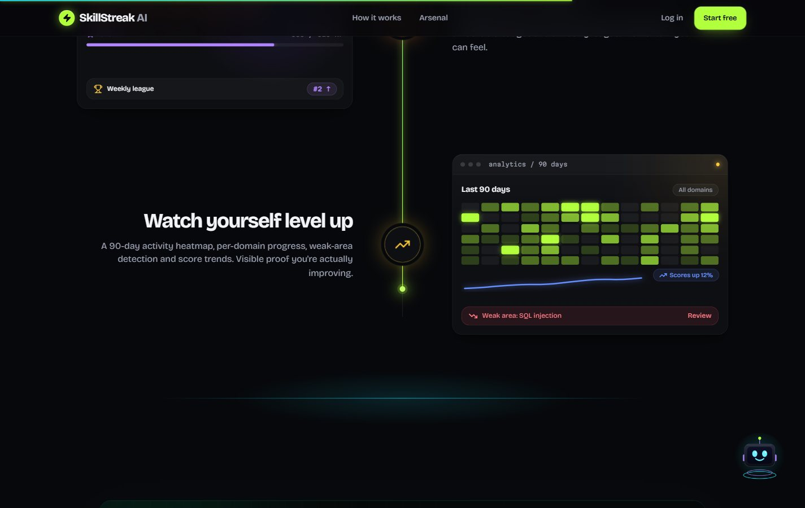

<div align="center">


# SkillStreak AI

### Master tech, one *streak* at a time.

An AI-mentored learning platform for nine tech domains. Personal roadmaps, lessons written for your level, quizzes checked by a second AI pass, and a streak that makes tomorrow easy.

[](https://github.com/Likith2005-coder/SkillStreak-AI/actions/workflows/ci.yml)
[](LICENSE)


**[Features](#-what-it-does)** · **[How the AI works](#-how-the-ai-works)** · **[Architecture](#-architecture)** · **[Algorithms](#-the-algorithms-inside)** · **[Run it](#-run-it-locally)**

<br>



</div>

<br>

## ⚡ At a glance

<div align="center">

| **9** | **582** | **37** | **12** | **8** | **~33k** |
|:---:|:---:|:---:|:---:|:---:|:---:|
| tech domains | curated topics, beginner → advanced | ethical-hacking tools with field guides | distinct AI features | unlockable badges | lines of strict TypeScript |

</div>

> **The problem.** Self-learners rarely fail for lack of content. They fail because nothing tells them *what to do next*, and nothing brings them *back tomorrow*.
>
> **The fix.** An AI mentor builds a plan around you, every lesson is written for your level, every quiz proves you learned it, and a streak turns "maybe later" into "just one topic today".

## 🧭 What it does

<table>
<tr>
<td width="50%" valign="top">

**🧠 AI mentor assessment**<br>
Pick a domain and a mentor interviews you one question at a time: goal, level, daily time, learning style, target role, certification, OS. It then writes your learner profile and a phased plan with resources, exercises, mini-projects, a capstone and a day-by-day Week 1.

</td>
<td width="50%"></td>
</tr>
<tr>
<td width="50%"></td>
<td width="50%" valign="top">

**🎬 A dashboard that tells you what's next**<br>
One clear next step, the path ahead, a daily XP goal ring, a week strip, your streak and freezes, and a choreographed opening shot. Mistake Review, level and weekly league sit one glance away.

</td>
</tr>
<tr>
<td width="50%" valign="top">

**🗺️ Nine curated roadmaps, 582 topics**<br>
Cybersecurity, Web Development, AI, Machine Learning, Data Science, Cloud, DevOps, Blockchain and IoT. Each one is ordered strictly *foundations → core → advanced*, and each topic opens a lesson anchored to where it sits in the course.

</td>
<td width="50%"></td>
</tr>
<tr>
<td width="50%"></td>
<td width="50%" valign="top">

**🛡️ Ethical Hacking Arsenal**<br>
Every phase of a real penetration test (recon → scan → access → post-exploit → report) with 37 tools such as Nmap, Burp Suite, sqlmap, Metasploit, Hydra and Hashcat. Each tool has a command-packed field guide, all inside a green phosphor terminal. It is a learning reference only and runs nothing.

</td>
</tr>
</table>

**And there's more:**

| | |
|---|---|
| 📖 **Lessons with diagrams and real images** | Nine fixed sections, one Mermaid diagram (repaired server-side so it always renders), and a real Wikipedia image with attribution. |
| ✅ **Quizzes checked twice** | Five MCQs per topic, generated, then each one checked by an independent AI reviewer. Pass with 3/5. |
| 💬 **Streaming AI tutor** | Knows your level and current topic, detects your intent (explain, roadmap, quiz, recommend, doubt, motivate), streams token by token and suggests follow-ups. |
| 🔁 **Mistake Review** | Every question you got wrong comes back until you get it right, for +5 XP each. |
| 🎯 **Recommendations by meaning** | Topics are embedded as vectors. Your "interest vector" finds the closest topics you haven't done, using pgvector cosine distance. |
| 🔥 **Streaks, XP, levels, badges, leagues** | UTC-day streaks with auto-spent freezes, a `100·N·log₂(N+1)` level curve, 8 badges and a weekly leaderboard. |
| 📊 **Progress analytics** | 90-day heatmap, per-domain progress, score trends and weak-area detection. |
| 💼 **Career path and interview prep** | Unlocked by finishing a domain: role roadmaps with certifications and salaries, plus 15-question mock interviews with a practice mode. |
| 🤖 **SignalBot** | An interactive SVG mascot that follows your cursor, reacts to what you hover and type, looks away when you type a password, gets dizzy, and narrates the page as you scroll. |
| 🛠️ **Admin console** | Live metrics, topic CRUD, user management and email dispatch. |

<p align="center"></p>

## 🤖 How the AI works

Every AI call goes through one guarded gateway with a circuit breaker, a timeout and a concurrency cap. The two features most likely to go wrong (quizzes and links) each have an extra safety net.



- **No invented links.** Videos come from real YouTube search and every ID is proven to exist through oEmbed before it is shown. AI-suggested IDs are used only if they pass the same check. Lesson images come from Wikipedia's API, never from the model.
- **Diagrams that always render.** The lesson prompt sets strict Mermaid rules, a server-side repair pass fixes the usual mistakes, and the browser parses before rendering, with a graceful fallback.
- **Streaming over SSE.** Chat replies arrive as Server-Sent Events read through `fetch` + `ReadableStream`, because `EventSource` can't send the `Authorization` header. There is a heartbeat every 15 s and cancel works at any point.
- **Prompt-injection guard.** Chat input is capped at 2,000 characters and screened for "ignore your instructions"-style patterns, and the system prompt refuses role overrides.
- **Cost control.** Aggressive caching shared per topic and level, regex intent detection before any AI call, per-route rate limits, a token cap on every call, and all 37 tool guides generated ahead of time.

## 🏗 Architecture



A clean three-tier design in an npm-workspaces monorepo:

```
frontend/   learner app: Next.js 14 App Router, Tailwind, Framer Motion, raw WebGL, Mermaid, zustand
backend/    REST API: Express, Prisma, Zod, JWT, bcrypt, rate limits, circuit breakers, Jest tests
admin/      admin console: metrics, content, users, email
docs/       screenshots and reference docs
```

**Request path.** `helmet → compression → CORS allowlist → JSON (1 MB) → rate limit (120/min) → route → Zod validation → JWT auth → controller → service → Prisma / cache / AI → error handler`

### Tech stack

| Layer | Technology |
|---|---|
| **Language** | TypeScript (strict) everywhere, plus SQL, GLSL shaders, CSS |
| **Frontend** | Next.js 14 (App Router), React 18, Tailwind CSS, Framer Motion, Lenis, raw WebGL 1/2, Mermaid, Recharts, Shiki, cmdk, Sonner |
| **State and forms** | zustand, react-hook-form + Zod, axios with a stale-while-revalidate GET cache |
| **Backend** | Node.js 20+, Express 4, Zod, jsonwebtoken (JWT), bcryptjs, helmet, express-rate-limit, compression |
| **Data** | PostgreSQL 16 + **pgvector**, Prisma 5 ORM, Redis (ioredis) with an in-memory fallback |
| **AI** | Google Gemini (`@google/generative-ai`) for text and `gemini-embedding-001` vectors |
| **External** | YouTube Data API + oEmbed, Wikipedia REST, Resend |
| **Quality** | Jest + ts-jest (circuit breaker, streaks, levels, intent, sanitiser, JWT…), ESLint, GitHub Actions CI with Postgres + Redis services |

## 🧮 The algorithms inside

<details>
<summary><b>Level curve</b>: logarithmic, so early levels come fast and later ones take real work</summary>

<br>

$$\text{XP needed for level } N = \operatorname{round}\big(100 \cdot N \cdot \log_2(N+1)\big)$$

| Level | 2 | 3 | 4 | 5 | 10 |
|---|---|---|---|---|---|
| Cumulative XP | 317 | 600 | 929 | 1,292 | 3,459 |

XP: topic +10 · first topic of the day +10 · streak day +5 · quiz pass +15 (perfect +25) · mistake fixed +5 · comeback +50.
</details>

<details>
<summary><b>Streak with auto-spent freezes</b>: computed lazily on UTC days, no cron job</summary>

<br>



You start with 1 freeze and gain 1 on Mondays, up to a cap of 2.
</details>

<details>
<summary><b>Semantic recommender</b>: pgvector cosine similarity</summary>

<br>

Each topic's title and summary are embedded into a 1,536-dimension vector. Your interest vector is the average of the topics you've completed. The next picks are the nearest unfinished topics:

$$\text{similarity}(\vec{t},\vec{u}) = \frac{\vec{t}\cdot\vec{u}}{\lVert\vec{t}\rVert\,\lVert\vec{u}\rVert} = 1 - \text{cosine distance}$$

In SQL that's `1 - (embedding <=> user_vec)`, where `<=>` is pgvector's cosine-distance operator.

New learners with nothing completed get the first unstarted foundations topics instead (a cold-start fallback).
</details>

<details>
<summary><b>Circuit breaker</b>: closed → open → half-open, with a timeout and a bulkhead</summary>

<br>

- After 4 consecutive AI failures (timeouts count), the circuit **opens** and calls fail fast for 15 s instead of piling up.
- It then goes **half-open** and lets exactly one probe through. Two successes close it again; any failure re-opens it.
- Each call has a 30 s timeout with an `AbortSignal`, and at most 6 run at once. Embeddings and YouTube have their own breakers, so one failing dependency never takes down the others.
</details>

<details>
<summary><b>More</b>: caching, Mistake Review, rate limiting, shuffling</summary>

<br>

- **Browser GET cache:** fresh for 60 s, stale-while-revalidate up to 10 min, simultaneous requests de-duplicated, keyed per account, and cleared on any write. Page-to-page navigation feels instant.
- **Mistake Review:** each question is identified by `SHA-256(topicId + normalised question)` cut to 20 hex characters. A question stays in the queue while your latest answer to it is wrong (60-day window, 20 items).
- **Rate limiting:** fixed-window counters, for example 120/min overall, 30 logins per 15 min, 20 chat messages/min and 10 quiz generations/min.
- **Interview practice:** Fisher–Yates shuffles, one seeded with an LCG so the order stays stable across re-renders.
</details>

<p align="center"></p>

## 🔐 Security

bcrypt password hashing · signed JWTs (7-day expiry, payload shape-checked) · role-based admin routes · Zod validation on every input · Helmet headers · a CORS allowlist · per-route rate limits · ownership checks on chat sessions · answers graded only on the server · prompt-injection screening · no stack traces outside development. See [SECURITY.md](SECURITY.md).

## 🎨 Design

A premium-dark language called **Midnight**: near-black panels that catch a cursor spotlight, one volt-green accent for progress, fixed colours for streak (ember), XP (gold) and level (violet), and big Bricolage Grotesque type with an Instrument Serif accent. The Arsenal keeps its own green terminal look.

Everything animates on transform and opacity only, heavy pieces (WebGL, Mermaid, charts, syntax highlighting) load only when needed, and **every animation has a reduced-motion fallback**. More in [`frontend/DESIGN.md`](frontend/DESIGN.md).

## 🚀 Run it locally

**Requires** Node.js 20+, npm 10+, and either Docker (for local Postgres + Redis) or a hosted Postgres with `pgvector` (such as Supabase).

```bash
git clone https://github.com/Likith2005-coder/SkillStreak-AI.git
cd SkillStreak-AI
npm install

npm run db:up                                   # Postgres + Redis in Docker (optional)
cp backend/.env.example backend/.env            # then add your keys (below)
cp frontend/.env.example frontend/.env.local

npm --workspace backend run db:migrate          # create the schema
npm --workspace backend run db:seed             # 9 domains, 582 topics

npm run dev                                     # learner app, API and admin together
```

> **On Windows?** Double-click `start-skillstreak.bat`. It starts the site and the API and opens your browser once they're ready.

| App | URL |
|---|---|
| Learner app | http://localhost:3000 |
| API | http://localhost:4000/api |
| Admin console | http://localhost:3001 |

<details>
<summary><b>Environment variables</b></summary>

<br>

| Variable | | Purpose |
|---|---|---|
| `DATABASE_URL` | required | Postgres with the `pgvector` extension |
| `JWT_SECRET` | required | A long random string (at least 16 characters) |
| `GEMINI_API_KEY` | required | Powers the mentor, tutor, lessons, quizzes and plans. [Get one free](https://aistudio.google.com/apikey) |
| `LLM_MODEL` | optional | Gemini model id (default `gemini-flash-lite-latest`) |
| `YOUTUBE_API_KEY` | optional | Direct video search; falls back to keyless, oEmbed-verified lookup |
| `REDIS_URL` | optional | Falls back to an in-memory cache |
| `RESEND_API_KEY` | optional | Weekly digest and streak reminder emails |

To use the admin console, promote your account after registering:

```bash
npm --workspace backend run grant-admin -- you@example.com
```
</details>

### Scripts

| Command | |
|---|---|
| `npm run dev` | Run the learner app, API and admin together |
| `npm run build` | Production build of the API and learner app |
| `npm run type-check` | TypeScript across every workspace |
| `npm run lint` · `npm test` | Lint and test every workspace |
| `npx tsx backend/scripts/apply-curriculum.ts` | Re-order roadmaps from the curriculum files (dry run; `--apply` to write) |

## 📁 Project map

```
backend/src
├── routes/        13 routers: auth, domains, topics, chat, quiz, progress, review, toolkit, career…
├── controllers/   HTTP in/out, Zod schemas, SSE streaming
├── services/      the logic: llm, quiz, chat, recommender, gamification, personalization…
├── prompts/       system, intent, quiz and tool-guide prompts
├── middleware/    auth (JWT), admin role, validation, errors
└── utils/         circuit breaker, JWT, bcrypt, sanitiser, review keys
backend/prisma     schema (15 models), 8 migrations, seed, 9 curriculum files

frontend/app       (auth) login/register · (dashboard) dashboard, domains, topic, quiz, review,
                   progress, leaderboard, chatbot, toolkit, settings · landing page
frontend/components landing · dashboard · mascot · chat · quiz · lesson · progress · gamification…
frontend/lib       api.ts (axios + GET cache + SSE), auth, level, shiki, domain styles
```

## 📄 License

[MIT](LICENSE) © Likith

<div align="center"><sub>Built with TypeScript, Gemini and a lot of streaks. 🔥</sub></div>
